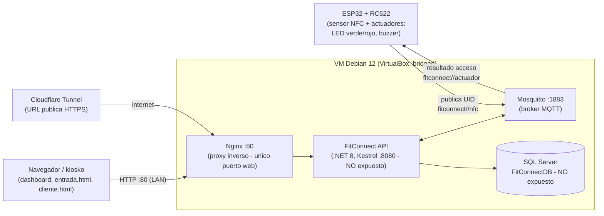

# Reporte de despliegue — FitConnect (Sistema IoT + Infraestructura Debian 12)

**Proyecto:** FitConnect — sistema de gestión de gimnasio con control de acceso NFC.
**Backend:** ASP.NET Core 8 (.NET 8) + SQL Server 2022. **Frontend:** HTML/JS estático.
**IoT:** ESP32 + lector RFID/NFC RC522, comunicación por **MQTT**.
**Infraestructura:** VM Debian 12 (VirtualBox) con Docker Compose, Nginx, Mosquitto y túnel Cloudflare.

---

## 1. Arquitectura



**Servicios (contenedores Docker):**

| Servicio | Imagen | Puerto host | Rol |
|---|---|---|---|
| `nginx` | nginx:alpine | **80** | Proxy inverso, único punto de entrada web |
| `api` | build local (.NET 8) | — (interno 8080) | API REST + sirve el frontend |
| `mosquitto` | eclipse-mosquitto:2 | **1883** | Broker MQTT (habla con el ESP32) |
| `db` | mssql/server:2022 | — (interno 1433) | Base de datos SQL Server |
| `db-init` | mssql-tools | — | Crea la BD al arrancar (corre una vez) |

> El backend (8080) y la BD (1433) **no se exponen** al host: solo son alcanzables por la red interna de Docker, a través de Nginx. Esto cumple el requisito "el puerto del backend no debe quedar expuesto directamente".

---

## 2. Cómo lo montamos (paso a paso)

### 2.1 Preparar la VM
- VirtualBox con **Debian 12**, 13 GB RAM, 2 vCPU, ~20 GB disco.
- Instalar Docker:
```bash
sudo apt update
curl -fsSL https://get.docker.com | sudo sh
sudo usermod -aG docker $USER    # cerrar sesion y reentrar
docker --version && docker compose version
```

### 2.2 Copiar el proyecto y configurar secretos
```bash
# desde Windows (scp) o git; se necesita la carpeta completa fitadmin-iis/
cd ~/fitadmin-iis/deploy
cp .env.example .env
nano .env      # SA_PASSWORD (fuerte) y JWT_KEY (>= 32 caracteres)
```

### 2.3 Levantar todo con un comando
```bash
docker compose up -d --build
```
Orden automático: `db` → `db-init` (crea `FitConnectDB`) → `mosquitto` + `api` → `nginx`.

### 2.4 Seguridad (endurecimiento)
```bash
# Firewall: solo los puertos necesarios
sudo apt-get install -y ufw
sudo ufw default deny incoming
sudo ufw default allow outgoing
sudo ufw allow 22/tcp      # SSH
sudo ufw allow 80/tcp      # web (Nginx)
sudo ufw allow 1883/tcp    # MQTT (ESP32)
sudo ufw --force enable

# SSH endurecido (solo llave, sin root)
sudo sed -i 's/^#\?PermitRootLogin.*/PermitRootLogin no/' /etc/ssh/sshd_config
sudo sed -i 's/^#\?PasswordAuthentication.*/PasswordAuthentication no/' /etc/ssh/sshd_config
sudo systemctl restart ssh
```

### 2.5 Túnel público (acceso desde internet, sin abrir puertos del router)
```bash
# binario estable 2024.12.2 (la version "latest" 2026.7.3 tiene un bug de DNS)
curl -sL https://github.com/cloudflare/cloudflared/releases/download/2024.12.2/cloudflared-linux-amd64 -o ~/cfbin
chmod +x ~/cfbin
~/cfbin tunnel --url http://localhost:80
# -> imprime una URL https://XXXX.trycloudflare.com
```

---

## 3. El componente IoT (ESP32 + MQTT)

**Hardware:** ESP32 + lector RC522 por SPI (GPIO18 SCK, 19 MISO, 23 MOSI, 22 RST, 5 CS).
Actuadores previstos: LED verde (acceso ok), LED rojo (denegado), buzzer.

**Protocolo:** MQTT (comunicación real, no simulada). Topics:

| Topic | Quién publica | Quién escucha | Payload |
|---|---|---|---|
| `fitconnect/<idSucursal>/nfc` | ESP32 | Backend | `{"uid":"07 C1 88 A1"}` |
| `fitconnect/<idSucursal>/actuador` | Backend / Dashboard | ESP32 | `{"accion":"acceso","estado":"ok\|denegado"}` |

**Flujo completo:**
1. El ESP32 lee el llavero y publica el UID en `fitconnect/1/nfc`.
2. El backend (suscrito a `fitconnect/+/nfc`) guarda la lectura, resuelve si el UID pertenece a un cliente con membresía vigente, y publica el resultado en `fitconnect/1/actuador`.
3. El ESP32 (suscrito) enciende el LED verde/rojo y el buzzer según el resultado.
4. El dashboard también puede mandar comandos manuales a los actuadores (`POST /api/actuadores/comando` → el backend publica por MQTT).

**Config en el ESP32** (`esp32/main.py`): `MQTT_BROKER` = IP de la VM, `ID_SUCURSAL`.
Instalar el módulo MQTT en MicroPython: `import mip; mip.install("umqtt.simple")`.

---

## 4. Configuración de red (nota importante)

- **Modo bridged (puente):** la VM toma una IP de la LAN (ej. `192.168.3.112`, es por DHCP y cambia). Es el modo de operación normal — permite que el ESP32, los kioscos y otros equipos alcancen la VM, y que el túnel Cloudflare resuelva DNS correctamente.
- **Modo NAT (solo temporal):** se usó únicamente para **descargar las imágenes de Docker rápido**, porque el adaptador puente sobre Wi-Fi estrangula la descarga desde internet (~40 KB/s). En NAT el SSH entra por `localhost:2222` (port-forward). **El túnel Cloudflare NO funciona en NAT**: el proxy DNS de VirtualBox rompe el descubrimiento de edge de cloudflared. Para servir y para el túnel: **bridged**.

---

## 5. Comandos útiles (operación y pruebas)

```bash
# --- Gestion del stack ---
docker compose ps                         # estado de los servicios
docker compose logs -f api                # logs del backend en vivo
docker compose up -d --build              # actualizar tras cambiar codigo
docker compose restart api                # reiniciar solo la app

# --- Probar MQTT a mano (dentro de la VM) ---
docker exec -it fitconnect-mqtt mosquitto_sub -t 'fitconnect/#' -v          # ver TODO el trafico
docker exec fitconnect-mqtt mosquitto_pub -t 'fitconnect/1/nfc' -m '{"uid":"11 22 33 44"}'

# --- Túnel ---
bash ~/start_tunnel.sh                     # arranca cloudflared (da URL nueva)
grep trycloudflare.com ~/cf.log            # ver la URL publica actual
```

**Credenciales de prueba (staff):**
- `admin@fitconnect.com` / `admin123` (admin general)
- `admin.central@fitconnect.com` / `central123` (admin de sede)

**Portal de clientes** (`/cliente.html`): entran con su **email** y contraseña (para los datos de prueba, la contraseña es la parte del email antes de la `@`).

---

## 6. Pruebas realizadas y resultados

| # | Prueba | Comando/acción | Resultado |
|---|---|---|---|
| 1 | Compilación backend | `dotnet build -c Release` | ✅ 0 errores |
| 2 | Stack levantado | `docker compose up -d --build` | ✅ 5 servicios "Up" |
| 3 | Backend conecta al broker | log de `api` | ✅ "MQTT conectado a mosquitto:1883, suscrito a fitconnect/+/nfc" |
| 4 | Nginx sirve la app | `curl localhost/login.html` | ✅ HTTP 200 (login, index, entrada, cliente) |
| 5 | Backend NO expuesto | `curl localhost:8080` | ✅ 000 (cerrado); solo 80 y 1883 publicados |
| 6 | MQTT round-trip (simulado) | `mosquitto_pub fitconnect/1/nfc` | ✅ backend responde en `fitconnect/1/actuador {"estado":"denegado"}` |
| 7 | **MQTT round-trip (hardware real)** | acercar llavero al ESP32 | ✅ `Llavero 07 C1 88 A1 -> Publicado por MQTT -> Acceso DENEGADO` |
| 8 | SSH endurecido | intento de login con contraseña | ✅ rechazado ("Permission denied (publickey)") |
| 9 | Sobrevive reinicios | `sudo reboot` | ✅ contenedores vuelven solos (restart:unless-stopped) |
| 10 | Túnel público | `curl https://…trycloudflare.com/login.html` | ✅ HTTP 200; login API por internet devuelve JWT |
| 11 | Acceso LAN | `curl http://192.168.3.112/login.html` | ✅ HTTP 200 |

> En las pruebas 6 y 7 el resultado "DENEGADO" es el **comportamiento correcto**: el UID todavía no está asignado a ningún cliente. Al asignar el llavero a un cliente con membresía vigente (desde el dashboard → Clientes → Asignar NFC), el mismo escaneo responde "PERMITIDO" y enciende el LED verde.

---

## 7. Estado frente a los criterios del proyecto

### Cumplido (software + infraestructura)
- ✅ **Nginx** como proxy inverso (backend no expuesto).
- ✅ **Comunicación IoT real por MQTT** (no simulada) — probada con hardware.
- ✅ **Persistencia** de las lecturas en el backend (SQL Server).
- ✅ **Control remoto de actuadores** desde el dashboard (vía MQTT).
- ✅ **Firewall UFW** (solo 22/80/1883).
- ✅ **SSH endurecido** (solo llave).
- ✅ **Sobrevive reinicios** (Docker + systemd).
- ✅ **Túnel público seguro** (Cloudflare).
- ✅ **Docker Compose** (tema opcional / bonus).
- ✅ **README replicable + diagrama de arquitectura**.

### Pendiente (hardware — a cargo del equipo)
- ⏳ **3 sensores + 3 actuadores físicos distintos**: hoy hay 1 sensor (NFC) + LED verde/rojo/buzzer sin conectar. El software de los actuadores ya está listo; falta cablearlos y poner `USAR_INDICADORES = True` en el ESP32.
- ⏳ **Maqueta física** (armado, aislamiento, seguridad eléctrica).
- ⏳ **CI/CD** (opcional / bonus) — no implementado.

---

*Documento generado como parte del despliegue de FitConnect. Ver también `deploy/README.md` (guía de instalación replicable).*
