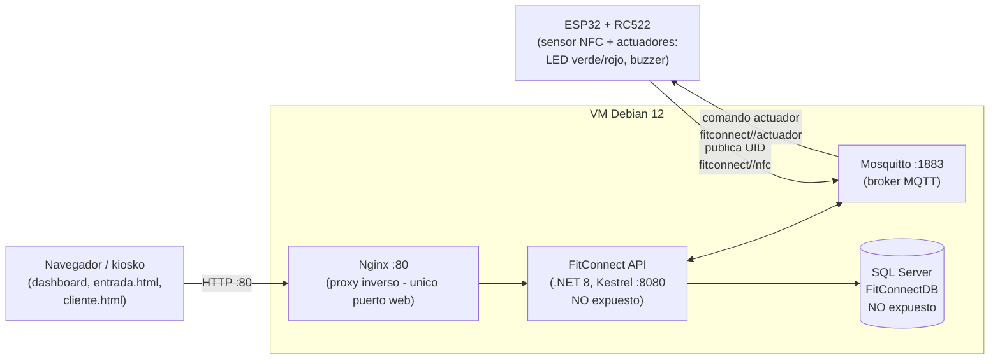

# Despliegue de FitConnect en Debian 12 (Docker Compose)

Sistema IoT + backend + infraestructura, en una VM Debian, con un solo comando.

## Arquitectura



**Flujo IoT (comunicación real por MQTT, no simulada):**
1. El ESP32 lee un llavero y **publica** el UID en `fitconnect/<idSucursal>/nfc`.
2. El backend (suscrito) guarda la lectura, resuelve el acceso y **publica** el resultado
   en `fitconnect/<idSucursal>/actuador` → el ESP32 enciende el LED verde/rojo y el buzzer.
3. Desde el dashboard (sección **Kiosko / Actuadores**) se pueden mandar comandos manuales
   a los actuadores; el backend los publica por el mismo topic.

## 0. Requisitos de la VM
- **RAM:** 4 GB mínimo (SQL Server usa ~2 GB), 2 vCPU, ~20 GB disco.
- **Red: adaptador en modo PUENTE (bridged)** para que la VM tenga IP de tu LAN
  (ej. 192.168.3.x) y el ESP32/kiosko puedan alcanzarla.
- Debian 12 (bookworm).

## 1. Instalar Docker
```bash
sudo apt update
curl -fsSL https://get.docker.com | sudo sh
sudo usermod -aG docker $USER
# cierra sesion y vuelve a entrar para aplicar el grupo 'docker'
docker --version && docker compose version
```

## 2. Copiar el proyecto a la VM
Necesitas la carpeta completa `fitadmin-iis/` (con `backend/`, `sql/`, `deploy/`).
```bash
# ejemplo con scp desde Windows:
# scp -r fitadmin-iis usuario@IP-VM:~/
cd ~/fitadmin-iis/deploy
```

## 3. Configurar secretos
```bash
cp .env.example .env
nano .env
```
- `SA_PASSWORD`: 8+ caracteres con mayúscula, minúscula, número y símbolo.
- `JWT_KEY`: **mínimo 32 caracteres**.

## 4. Levantar todo
```bash
docker compose up -d --build
```
Orden automático: `db` → `db-init` (crea `FitConnectDB`) → `mosquitto` + `api` → `nginx`.

```bash
docker compose ps                # estado de los 5 servicios
docker compose logs -f api       # logs de la app (incluye "MQTT conectado...")
```

## 5. Endurecer SSH (obligatorio)
```bash
sudo nano /etc/ssh/sshd_config
#   PermitRootLogin no
#   PasswordAuthentication no        # solo si ya cargaste tu llave publica (ssh-copy-id)
sudo systemctl restart ssh
```

## 6. Firewall UFW (obligatorio: solo los puertos necesarios)
```bash
sudo ufw default deny incoming
sudo ufw default allow outgoing
sudo ufw allow 22/tcp        # SSH
sudo ufw allow 80/tcp        # web (Nginx)
sudo ufw allow 1883/tcp      # MQTT (ESP32)
sudo ufw enable
sudo ufw status verbose
```
> La BD (1433) y el backend (8080) **no** se exponen: solo viven en la red interna de Docker.

## 7. Acceso público con túnel seguro (obligatorio)
Sin abrir puertos en el router. Con **Cloudflare Tunnel** (gratis):
```bash
# instalar cloudflared
curl -L https://github.com/cloudflare/cloudflared/releases/latest/download/cloudflared-linux-amd64 \
  -o cloudflared && chmod +x cloudflared && sudo mv cloudflared /usr/local/bin/
# tunel rapido a Nginx (da una URL publica https://xxxx.trycloudflare.com)
cloudflared tunnel --url http://localhost:80
```
Alternativa con ngrok: `ngrok http 80`.

## 8. Persistencia tras reinicio (obligatorio)
Docker ya está gestionado por systemd y los contenedores usan `restart: unless-stopped`,
así que la app **vuelve sola** al reiniciar la VM. Verifícalo:
```bash
sudo systemctl enable docker    # que Docker arranque en el boot
sudo reboot
# al volver:  docker compose ps   -> todo "Up" sin intervencion manual
```

## 9. Probar
- Web (LAN):   `http://IP-DE-LA-VM/login.html`
  - admin@fitconnect.com / admin123
  - recepcion.central@fitconnect.com / recepcion123
- Kiosko:      `http://IP-DE-LA-VM/entrada.html` (sesión de usuario kiosko)
- Portal:      `http://IP-DE-LA-VM/cliente.html`

## 10. Apuntar el ESP32 a la VM
En `esp32/main.py`: `MQTT_BROKER = "IP-DE-LA-VM"`, ajusta `ID_SUCURSAL`, y sube el archivo.
El ESP32 necesita el módulo MQTT: en la consola de MicroPython,
`import mip; mip.install("umqtt.simple")`.

---

## Comandos útiles
```bash
docker compose down            # detener (conserva datos)
docker compose up -d --build   # actualizar tras cambiar codigo
docker compose restart api     # reiniciar solo la app
docker compose logs -f api

# Probar MQTT a mano (dentro de la VM):
docker exec -it fitconnect-mqtt mosquitto_sub -t 'fitconnect/#' -v   # ver todo el trafico
docker exec -it fitconnect-mqtt mosquitto_pub -t 'fitconnect/1/nfc' -m '{"uid":"11 22 33 44"}'
```

## Notas
- Para HTTPS local se puede añadir Caddy o certbot sobre Nginx; el túnel (paso 7) ya da HTTPS público.
